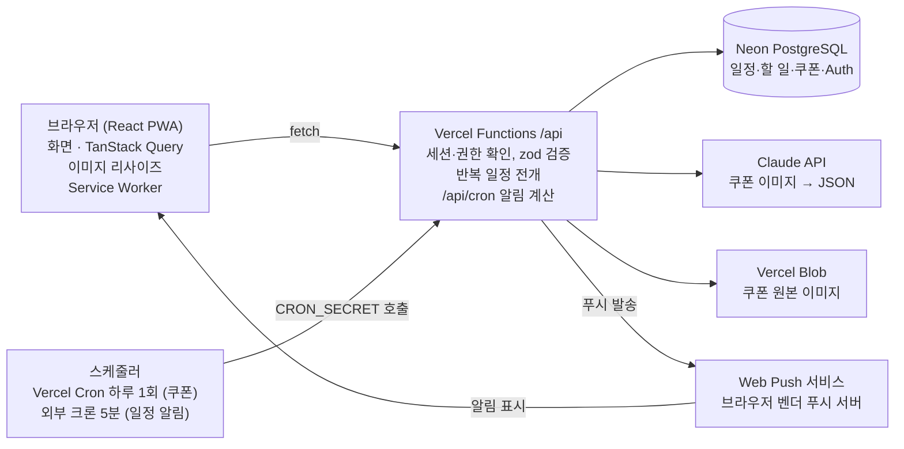

# 3트랙 캘린더 웹앱 기술명세서

작성일: 2026-10-13

## 1. 개요

회사·개인·쿠폰 3개 트랙을 한 화면에서 전환하는 모바일 우선 캘린더 웹앱이다. React/Vite 프론트엔드, Vercel Serverless Functions API, Neon PostgreSQL, Claude API(쿠폰 이미지 인식)로 구성하고 Vercel에 배포한다. 바이브 코딩 프로젝트 지시사항의 **MVP 트랙**을 적용한다.

| 트랙 | 목적 | 핵심 기능 |
| --- | --- | --- |
| 회사(업무) | 팀 업무 일정 관리 | 일정 CRUD, 반복 일정, 팀 공유(권한), 알림 |
| 개인 | 개인 일정·할 일 관리 | 일정 CRUD, 할 일 체크리스트, 알림 |
| 쿠폰 | 모바일 쿠폰 유효기한 관리 | 사진 업로드 → Claude가 상품명·유효기한 추출 → 캘린더 자동 등록, 만료 전 알림 |

**범위(MVP)**: 웹 브라우저(모바일·데스크톱) PWA. 네이티브 앱, 외부 캘린더 양방향 동기화, 결제는 범위 외로 두고 로드맵에서 다룬다.

## 2. 기술 스택

요청한 4개 축(React/Vite, Neon, Claude API, Vercel)을 그대로 쓰고, 인증·파일·푸시만 최소 라이브러리로 보강한다.

| 영역 | 기술 | 선택 이유 |
| --- | --- | --- |
| 프론트엔드 | React 19 + Vite, JavaScript, React Router | MVP 트랙 표준, 빠른 HMR |
| 서버 상태 | TanStack Query | 캐싱·재시도·낙관적 업데이트로 캘린더 이동 시 체감 속도 확보 |
| 캘린더 UI | FullCalendar (React) | 월/주/일/리스트 뷰, 드래그 이동을 직접 구현하지 않기 위함 |
| 날짜·반복 | date-fns, rrule | 시간대 계산, RFC 5545 반복 규칙 전개 |
| 백엔드 | Vercel Serverless Functions (`/api`, Node.js) | 별도 서버 없이 배포 일원화 |
| DB | Neon PostgreSQL + `@neondatabase/serverless` | 서버리스 연결, 태그드 템플릿 파라미터 바인딩 |
| 인증 | Neon Auth (Managed Better Auth) | 사용자 테이블이 같은 Neon DB에 저장, Vite+React 지원, Google OAuth |
| AI | Claude API (`@anthropic-ai/sdk`), 기본 `claude-haiku-5-5` | 쿠폰 이미지 → 구조화 JSON 추출 |
| 이미지 저장 | Vercel Blob | 쿠폰 원본 보관, Vercel 프로젝트와 통합 |
| 푸시 알림 | Web Push (VAPID, `web-push`) + Service Worker | 앱스토어 없이 PWA 알림 |
| 스케줄러 | Vercel Cron (일 1회) + 외부 스케줄러(분 단위) | Hobby 플랜 제약 대응 (8장) |
| 입력 검증 | zod | API 입력값 검증과 Claude 응답 검증에 같은 스키마 재사용 |
| 품질 | ESLint, Prettier | 프로젝트 지시사항 7장 |

인증은 [Neon Auth 로드맵](https://neon.com/docs/auth/roadmap.md)에서 Vite + React와 Google 소셜 로그인을 지원한다. 다만 문서별로 베타·정식 표기가 섞여 있어 착수 시점에 상태를 다시 확인한다.

## 3. 시스템 아키텍처

브라우저는 DB·Claude·Blob에 직접 닿지 않고 모든 요청을 `/api`로 보낸다. 알림은 스케줄러가 `/api/cron`을 깨우면 Web Push로 브라우저에 전달된다.



**쿠폰 등록 흐름**

1. 브라우저에서 사진 선택 → 긴 변 1568px로 리사이즈
2. `POST /api/coupons/upload` → Vercel Blob 저장 → Claude로 정보 추출 → 결과 반환(아직 DB 저장 안 함)
3. 확인 폼에서 사용자가 값 수정·확정
4. `POST /api/coupons` → 한 트랜잭션으로 `events`(종일 일정) + `coupons` + `reminders`(D-7·D-3·D-1) 저장
5. 매일 KST 9시 크론이 만료 임박 쿠폰을 찾아 푸시 발송

## 4. 기능 명세

P0 = MVP 필수, P1 = MVP 직후, P2 = 확장. 세 트랙은 하나의 `events` 테이블을 `track` 값으로 구분해 공유하므로 캘린더 화면에서 트랙 토글로 겹쳐 볼 수 있다.

### 4.1 공통

| ID | 기능 | 상세 | 우선순위 |
| --- | --- | --- | --- |
| C-01 | 회원가입·로그인 | 이메일/비밀번호, Google 로그인 | P0 |
| C-02 | 트랙 전환 | 상단 세그먼트 버튼 [회사 · 개인 · 쿠폰 · 전체] | P0 |
| C-03 | 캘린더 뷰 | 월·주·일·리스트, 트랙별 색상 | P0 |
| C-04 | 알림 설정 | 기본 알림 시점, 푸시 허용, 방해금지 시간 | P0 |
| C-05 | 검색 | 제목·메모 키워드 검색 | P1 |
| C-06 | 다크 모드 | 시스템 설정 연동 + 수동 전환 | P0 |

### 4.2 회사(업무) 트랙

| ID | 기능 | 상세 | 우선순위 |
| --- | --- | --- | --- |
| W-01 | 업무 일정 CRUD | 제목, 시작·종료, 종일, 장소, 메모, 담당자 | P0 |
| W-02 | 반복 일정 | 매일·매주(요일)·매월(일자/n번째 요일)·매년, 종료일·횟수 | P0 |
| W-03 | 반복 회차 수정 | "이 일정만 / 이후 모든 일정 / 전체" 선택 | P0 |
| W-04 | 워크스페이스 | 회사·팀 단위 공유 캘린더 생성 | P0 |
| W-05 | 멤버 초대 | 초대 링크(만료 7일), 역할 owner·editor·viewer | P0 |
| W-06 | 일정 알림 | 10분·1시간·1일 전 등 다중 알림 | P0 |
| W-07 | 변경 알림 | 공유 일정 생성·수정·삭제 시 멤버에게 푸시 | P1 |
| W-08 | ICS 내보내기 | 구글·아웃룩에서 구독 가능한 읽기 전용 URL | P2 |

### 4.3 개인 트랙

| ID | 기능 | 상세 | 우선순위 |
| --- | --- | --- | --- |
| P-01 | 개인 일정 CRUD | W-01과 동일 필드(담당자 제외), 본인만 열람 | P0 |
| P-02 | 할 일 CRUD | 제목, 마감일(선택), 우선순위, 완료 체크 | P0 |
| P-03 | 할 일 캘린더 표시 | 마감일이 있는 할 일을 해당 날짜에 표시 | P0 |
| P-04 | 일정·할 일 알림 | 일정 시작 전, 할 일 마감 당일 오전 | P0 |
| P-05 | 반복 할 일 | 매일·매주 루틴 | P1 |

### 4.4 쿠폰 트랙

| ID | 기능 | 상세 | 우선순위 |
| --- | --- | --- | --- |
| K-01 | 쿠폰 사진 업로드 | 카메라 촬영·갤러리 선택, 최대 5MB, JPG·PNG·WEBP | P0 |
| K-02 | AI 정보 추출 | Claude가 브랜드, 상품명, 유효기한, 바코드 번호, 금액 추출 | P0 |
| K-03 | 확인·수정 화면 | 추출값을 폼에 채워 보여주고 사용자가 확정 (신뢰도 낮은 필드 강조) | P0 |
| K-04 | 캘린더 자동 등록 | 확정 시 유효기한 날짜에 종일 일정 생성 | P0 |
| K-05 | 만료 알림 | D-7, D-3, D-1 오전 9시(KST) 푸시 | P0 |
| K-06 | 쿠폰함 | 사용 가능·사용 완료·만료 탭, 만료 임박 순 정렬 | P0 |
| K-07 | 사용 완료 처리 | 체크 시 이후 알림 중지 | P0 |
| K-08 | 바코드 크게 보기 | 원본 이미지 확대 표시(매장 제시용) | P1 |

## 5. DB 스키마

테이블 10개로 구성한다. 사용자 계정은 Neon Auth가 `neon_auth` 스키마에 관리하므로, 앱 테이블은 사용자 ID를 `TEXT`로 참조한다.

| 테이블 | 역할 | 주요 컬럼 |
| --- | --- | --- |
| workspaces | 회사·팀 공유 단위 | id, name, owner_id |
| workspace_members | 멤버·권한 | workspace_id, user_id, role |
| workspace_invites | 초대 링크 | token, workspace_id, role, expires_at |
| events | 세 트랙 공통 일정 | track, workspace_id, owner_id, start_at, end_at, all_day, rrule |
| event_exceptions | 반복 일정 단일 회차 수정·삭제 | event_id, original_start, is_cancelled, 덮어쓸 값 |
| reminders | 알림 시점 정의 | event_id 또는 todo_id, offset_minutes |
| todos | 개인 할 일 | owner_id, title, due_date, priority, done |
| coupons | 쿠폰 상세 | event_id, image_url, brand, product_name, expires_on, barcode, status |
| push_subscriptions | 기기별 푸시 구독 | user_id, endpoint, p256dh, auth |
| notification_log | 발송 이력(중복 방지) | dedupe_key, user_id, sent_at |

```sql
-- db/schema.sql
CREATE EXTENSION IF NOT EXISTS pgcrypto;

CREATE TABLE workspaces (
  id          UUID PRIMARY KEY DEFAULT gen_random_uuid(),
  name        VARCHAR(100) NOT NULL,
  owner_id    TEXT NOT NULL,
  created_at  TIMESTAMPTZ NOT NULL DEFAULT now()
);

CREATE TABLE workspace_members (
  workspace_id UUID NOT NULL REFERENCES workspaces(id) ON DELETE CASCADE,
  user_id      TEXT NOT NULL,
  role         VARCHAR(10) NOT NULL CHECK (role IN ('owner','editor','viewer')),
  joined_at    TIMESTAMPTZ NOT NULL DEFAULT now(),
  PRIMARY KEY (workspace_id, user_id)
);

CREATE TABLE workspace_invites (
  token        VARCHAR(64) PRIMARY KEY,
  workspace_id UUID NOT NULL REFERENCES workspaces(id) ON DELETE CASCADE,
  role         VARCHAR(10) NOT NULL CHECK (role IN ('editor','viewer')),
  created_by   TEXT NOT NULL,
  expires_at   TIMESTAMPTZ NOT NULL
);

CREATE TABLE events (
  id           UUID PRIMARY KEY DEFAULT gen_random_uuid(),
  track        VARCHAR(10) NOT NULL CHECK (track IN ('work','personal','coupon')),
  workspace_id UUID REFERENCES workspaces(id) ON DELETE CASCADE, -- work 트랙만 사용
  owner_id     TEXT NOT NULL,
  title        VARCHAR(200) NOT NULL,
  memo         TEXT,
  location     VARCHAR(200),
  assignee_id  TEXT,
  start_at     TIMESTAMPTZ NOT NULL,
  end_at       TIMESTAMPTZ NOT NULL,
  all_day      BOOLEAN NOT NULL DEFAULT false,
  timezone     VARCHAR(50) NOT NULL DEFAULT 'Asia/Seoul',
  rrule        TEXT,            -- 예: FREQ=WEEKLY;BYDAY=MO,WE;UNTIL=20261231T000000Z
  created_at   TIMESTAMPTZ NOT NULL DEFAULT now(),
  updated_at   TIMESTAMPTZ NOT NULL DEFAULT now(),
  CHECK (end_at >= start_at),
  CHECK (track <> 'work' OR workspace_id IS NOT NULL)
);
CREATE INDEX idx_events_owner_range ON events (owner_id, start_at);
CREATE INDEX idx_events_ws_range    ON events (workspace_id, start_at);

CREATE TABLE event_exceptions (
  id             UUID PRIMARY KEY DEFAULT gen_random_uuid(),
  event_id       UUID NOT NULL REFERENCES events(id) ON DELETE CASCADE,
  original_start TIMESTAMPTZ NOT NULL,  -- 원래 회차의 시작 시각
  is_cancelled   BOOLEAN NOT NULL DEFAULT false,
  title          VARCHAR(200),
  start_at       TIMESTAMPTZ,
  end_at         TIMESTAMPTZ,
  UNIQUE (event_id, original_start)
);

CREATE TABLE todos (
  id         UUID PRIMARY KEY DEFAULT gen_random_uuid(),
  owner_id   TEXT NOT NULL,
  title      VARCHAR(200) NOT NULL,
  due_date   DATE,
  priority   SMALLINT NOT NULL DEFAULT 2 CHECK (priority BETWEEN 1 AND 3),
  done       BOOLEAN NOT NULL DEFAULT false,
  created_at TIMESTAMPTZ NOT NULL DEFAULT now()
);
CREATE INDEX idx_todos_owner_due ON todos (owner_id, due_date);

CREATE TABLE reminders (
  id             UUID PRIMARY KEY DEFAULT gen_random_uuid(),
  event_id       UUID REFERENCES events(id) ON DELETE CASCADE,
  todo_id        UUID REFERENCES todos(id) ON DELETE CASCADE,
  offset_minutes INTEGER NOT NULL CHECK (offset_minutes >= 0), -- 시작 n분 전
  CHECK ((event_id IS NULL) <> (todo_id IS NULL))
);

CREATE TABLE coupons (
  id           UUID PRIMARY KEY DEFAULT gen_random_uuid(),
  event_id     UUID UNIQUE REFERENCES events(id) ON DELETE CASCADE,
  owner_id     TEXT NOT NULL,
  image_url    TEXT NOT NULL,
  brand        VARCHAR(100),
  product_name VARCHAR(200) NOT NULL,
  expires_on   DATE NOT NULL,
  barcode      VARCHAR(64),
  amount       INTEGER,
  status       VARCHAR(10) NOT NULL DEFAULT 'active' CHECK (status IN ('active','used','expired')),
  ai_result    JSONB,          -- Claude 원본 응답(재검토·품질 개선용)
  created_at   TIMESTAMPTZ NOT NULL DEFAULT now()
);
CREATE INDEX idx_coupons_owner_exp ON coupons (owner_id, status, expires_on);

CREATE TABLE push_subscriptions (
  id         UUID PRIMARY KEY DEFAULT gen_random_uuid(),
  user_id    TEXT NOT NULL,
  endpoint   TEXT NOT NULL UNIQUE,
  p256dh     TEXT NOT NULL,
  auth       TEXT NOT NULL,
  created_at TIMESTAMPTZ NOT NULL DEFAULT now()
);

CREATE TABLE notification_log (
  dedupe_key VARCHAR(200) PRIMARY KEY, -- 예: reminder:{id}:{occurrence}, coupon:{id}:D-3
  user_id    TEXT NOT NULL,
  sent_at    TIMESTAMPTZ NOT NULL DEFAULT now()
);
```

`notification_log`의 기본키로 중복 발송을 막는다. 스케줄러가 재시도되거나 두 번 실행돼도 같은 알림은 한 번만 나간다.

## 6. API 명세

모든 API는 `/api/*` REST 규칙을 따르고, 인증된 사용자만 호출한다. 응답은 성공 `{ ok: true, data }`, 실패 `{ ok: false, error: { code, message } }` 형식으로 통일한다.

| 메서드 | 경로 | 설명 | 권한 |
| --- | --- | --- | --- |
| GET | `/api/events?from=&to=&track=` | 기간 내 일정 조회. 반복 일정은 서버에서 회차로 전개해 반환 | 본인 + 소속 워크스페이스 |
| POST | `/api/events` | 일정 생성 (reminders 배열 포함) | work는 editor 이상 |
| PATCH | `/api/events/:id?scope=this\|following\|all&occurrence=` | 일정 수정, 반복 회차 범위 지정 | 작성자 또는 editor 이상 |
| DELETE | `/api/events/:id?scope=&occurrence=` | 일정 삭제, 반복 회차 범위 지정 | 작성자 또는 editor 이상 |
| GET | `/api/todos?due_from=&due_to=` | 할 일 조회 | 본인 |
| POST | `/api/todos` | 할 일 생성 | 본인 |
| PATCH | `/api/todos/:id` | 할 일 수정·완료 체크 | 본인 |
| DELETE | `/api/todos/:id` | 할 일 삭제 | 본인 |
| GET | `/api/workspaces` | 내 워크스페이스 목록 | 본인 |
| POST | `/api/workspaces` | 워크스페이스 생성 (생성자 owner) | 로그인 사용자 |
| GET | `/api/workspaces/:id/members` | 멤버 목록 | 멤버 |
| PATCH | `/api/workspaces/:id/members/:userId` | 역할 변경 | owner |
| DELETE | `/api/workspaces/:id/members/:userId` | 멤버 제외·탈퇴 | owner 또는 본인 |
| POST | `/api/workspaces/:id/invites` | 초대 링크 발급 | owner |
| POST | `/api/invites/:token/accept` | 초대 수락 | 로그인 사용자 |
| POST | `/api/coupons/upload` | 이미지 업로드 → Blob 저장 → Claude 추출 결과 반환 (DB 미저장) | 본인 |
| POST | `/api/coupons` | 확인된 쿠폰 저장 + 캘린더 일정·알림 생성 (트랜잭션) | 본인 |
| GET | `/api/coupons?status=` | 쿠폰함 조회 | 본인 |
| PATCH | `/api/coupons/:id` | 정보 수정·사용 완료 처리 | 본인 |
| DELETE | `/api/coupons/:id` | 쿠폰·연결 일정 삭제 | 본인 |
| POST | `/api/push/subscribe` | 푸시 구독 등록 | 본인 |
| DELETE | `/api/push/subscribe` | 구독 해제 | 본인 |
| GET | `/api/cron/reminders` | 다가오는 일정·할 일 알림 발송 | `CRON_SECRET` |
| GET | `/api/cron/coupons` | 쿠폰 만료 알림 발송, 만료 상태 갱신 | `CRON_SECRET` |

| HTTP | code | 상황 |
| --- | --- | --- |
| 400 | VALIDATION_ERROR | 필수값 누락, 형식·길이 오류 |
| 401 | UNAUTHORIZED | 로그인 필요 |
| 403 | FORBIDDEN | 워크스페이스 권한 부족 |
| 404 | NOT_FOUND | 대상 없음 또는 접근 불가 |
| 413 | FILE_TOO_LARGE | 이미지 5MB 초과 |
| 422 | EXTRACTION_FAILED | 쿠폰 정보 인식 실패 (수동 입력 유도) |
| 500 | INTERNAL_ERROR | 서버 오류 (내부 정보 미노출) |

## 7. Claude API 쿠폰 인식

쿠폰 인식은 `claude-haiku-5-5`로 1차 추출하고, 신뢰도가 낮으면 `claude-sonnet-5-5`로 한 번 재시도한다. 결과는 반드시 사용자가 확인한 뒤 저장한다.

| 항목 | 설계 |
| --- | --- |
| 모델 | 기본 `claude-haiku-5-5` (추출 작업용, 가장 빠름), 재시도 `claude-sonnet-5-5` |
| 입력 | 이미지 base64 + 오늘 날짜(KST) + 추출 지시 |
| 출력 강제 | 도구 1개(`save_coupon`)를 정의하고 `tool_choice`로 호출을 강제해 JSON 스키마대로 받기 |
| 검증 | 응답을 zod로 재검증, 날짜 형식·과거 날짜 확인 |
| 재시도 조건 | `confidence < 0.7` 또는 `expires_on` 누락 |
| 전처리 | 브라우저에서 긴 변 1568px 이하로 리사이즈, JPEG 품질 0.85 → 토큰·업로드 시간 절감 |
| 실패 처리 | 422 반환 → 빈 폼으로 수동 입력 전환 |

**호출 비용 추정 (1장 기준)**: 이미지 약 1,600 토큰 + 프롬프트 약 400 토큰 입력, 출력 약 200 토큰. Haiku 5.5 기준 약 $0.0003, Sonnet 5.5 재시도 시 약 $0.006이다. 단가는 [모델 개요](https://platform.claude.com/docs/en/models/overview)의 2026-10 기준 값이며 Haiku는 최저 단가 표기라 실제는 다를 수 있다.

```js
// api/_lib/couponExtractor.js
// 쿠폰 이미지 → 구조화 데이터 추출. tool_choice로 JSON 형식을 강제하는 이유:
// 자유 텍스트 응답을 파싱하면 형식이 흔들려 저장 단계에서 오류가 나기 때문.
import Anthropic from '@anthropic-ai/sdk';
import { z } from 'zod';

const client = new Anthropic({ apiKey: process.env.ANTHROPIC_API_KEY });

const PRIMARY_MODEL = 'claude-haiku-5-5';
const FALLBACK_MODEL = 'claude-sonnet-5-5';

const couponSchema = z.object({
  is_coupon: z.boolean(),
  brand: z.string().max(100).nullable(),
  product_name: z.string().max(200).nullable(),
  expires_on: z.string().regex(/^\d{4}-\d{2}-\d{2}$/).nullable(),
  barcode: z.string().max(64).nullable(),
  amount: z.number().int().nonnegative().nullable(),
  confidence: z.number().min(0).max(1),
});

const saveCouponTool = {
  name: 'save_coupon',
  description: '쿠폰 이미지에서 읽은 정보를 저장한다.',
  input_schema: {
    type: 'object',
    properties: {
      is_coupon: { type: 'boolean', description: '이미지가 쿠폰·기프티콘인지 여부' },
      brand: { type: ['string', 'null'], description: '사용처 브랜드 (예: 스타벅스)' },
      product_name: { type: ['string', 'null'], description: '상품명 또는 쿠폰명' },
      expires_on: { type: ['string', 'null'], description: '유효기간 마지막 날, YYYY-MM-DD' },
      barcode: { type: ['string', 'null'], description: '바코드·쿠폰 번호 숫자열 (공백 제거)' },
      amount: { type: ['integer', 'null'], description: '금액권이면 원 단위 금액' },
      confidence: { type: 'number', description: '유효기한 판독 확신도 0~1' },
    },
    required: ['is_coupon', 'brand', 'product_name', 'expires_on', 'barcode', 'amount', 'confidence'],
  },
};

function buildPrompt(todayKst) {
  return [
    `오늘 날짜는 ${todayKst}(한국 시간)이다.`,
    '이미지는 한국 모바일 쿠폰(기프티콘)일 가능성이 높다.',
    '- "유효기간", "사용기한", "~까지" 옆의 날짜를 expires_on으로 쓴다. 발행일·주문일과 혼동하지 않는다.',
    '- "26.12.31"처럼 연도가 2자리면 20XX년으로 해석한다.',
    '- 기간이 "발행일로부터 90일"처럼 상대값이면 이미지 속 발행일로 계산하고, 발행일이 없으면 null로 둔다.',
    '- 읽을 수 없는 값은 추측하지 말고 null로 둔다.',
    '반드시 save_coupon 도구로 답한다.',
  ].join('\n');
}

async function callModel(model, imageBase64, mediaType, todayKst) {
  const response = await client.messages.create({
    model,
    max_tokens: 1024,
    tools: [saveCouponTool],
    tool_choice: { type: 'tool', name: 'save_coupon' },
    messages: [
      {
        role: 'user',
        content: [
          { type: 'image', source: { type: 'base64', media_type: mediaType, data: imageBase64 } },
          { type: 'text', text: buildPrompt(todayKst) },
        ],
      },
    ],
  });
  const toolUse = response.content.find((block) => block.type === 'tool_use');
  if (!toolUse) throw new Error('NO_TOOL_USE');
  return couponSchema.parse(toolUse.input);
}

// 1차 Haiku → 신뢰도 낮으면 Sonnet으로 1회 재시도 (비용과 정확도의 균형)
export async function extractCoupon({ imageBase64, mediaType, todayKst }) {
  const first = await callModel(PRIMARY_MODEL, imageBase64, mediaType, todayKst);
  const needsRetry = first.is_coupon && (first.confidence < 0.7 || !first.expires_on);
  if (!needsRetry) return { ...first, model: PRIMARY_MODEL };

  const second = await callModel(FALLBACK_MODEL, imageBase64, mediaType, todayKst);
  return { ...second, model: FALLBACK_MODEL };
}
```

## 8. 반복 일정·알림 설계

반복 일정은 규칙 1행 + 예외 행으로 저장하고, 알림은 스케줄러가 주기적으로 "곧 울려야 할 알림"을 찾아 Web Push로 보낸다.

### 8.1 반복 일정

| 항목 | 설계 |
| --- | --- |
| 저장 | `events.rrule`에 RFC 5545 규칙 문자열 1개 저장 (회차를 행으로 복제하지 않음) |
| 조회 | `GET /api/events?from&to` 요청 시 서버에서 `rrule` 라이브러리로 해당 기간 회차만 전개 |
| 시간대 | `Asia/Seoul` 기준으로 전개 후 UTC로 반환 → 서머타임 없는 한국에서도 해외 출장 일정 대비 |
| 이 일정만 수정 | `event_exceptions`에 `original_start` + 덮어쓸 값 저장 |
| 이 일정만 삭제 | `event_exceptions.is_cancelled = true` |
| 이후 모든 일정 | 원본 `rrule`에 `UNTIL`(직전 회차)을 넣어 끊고, 새 events 행으로 분리 |
| 전체 수정 | 원본 행 수정 (기존 예외는 유지) |

### 8.2 알림 발송

| 알림 | 계산 방식 | 스케줄 |
| --- | --- | --- |
| 일정 알림 (회사·개인) | 회차 시작 시각 − `offset_minutes` | 5분 주기 |
| 할 일 마감 | 마감일 오전 9시(KST) | 5분 주기 실행 시 함께 처리 |
| 쿠폰 만료 | `expires_on` 기준 D-7, D-3, D-1 오전 9시(KST) | 하루 1회 |
| 공유 일정 변경 (P1) | API에서 변경 직후 멤버에게 즉시 발송 | 이벤트 기반 |

**Vercel 플랜 제약**: Hobby 플랜의 Vercel Cron은 하루 1회 이하로만 실행된다 ([Vercel Cron 제약 정리](https://crontap.com/blog/vercel-cron-hourly-limit-and-how-to-beat-it)). 따라서 아래처럼 나눈다.

| 작업 | Hobby(무료) | Pro |
| --- | --- | --- |
| `/api/cron/coupons` | Vercel Cron `0 0 * * *` (UTC 0시 = KST 9시) | 동일 |
| `/api/cron/reminders` | 외부 스케줄러(cron-job.org 등)가 5분마다 호출 | Vercel Cron `*/5 * * * *` |

두 크론 엔드포인트 모두 `Authorization: Bearer ${CRON_SECRET}` 헤더를 검증한다. 발송 전 `notification_log`에 `dedupe_key`를 `INSERT … ON CONFLICT DO NOTHING`으로 먼저 기록하고, 삽입된 경우에만 푸시를 보낸다.

**Web Push 주의점**: iPhone은 사용자가 웹앱을 홈 화면에 추가(PWA 설치)해야 푸시를 받을 수 있다. 첫 실행 시 설치 안내 배너와 알림 권한 요청 화면을 둔다. 만료된 구독(HTTP 404·410)은 `push_subscriptions`에서 삭제한다.

## 9. 화면 설계·UI 기준·폴더 구조

화면은 8개이며, 모바일에서는 하단 탭(캘린더·할 일·쿠폰함·설정), 데스크톱에서는 좌측 사이드바로 같은 메뉴를 제공한다.

| 화면 | 경로 | 핵심 요소 |
| --- | --- | --- |
| 로그인 | `/login` | 이메일·Google 로그인 |
| 캘린더 | `/` | 상단 트랙 세그먼트 [회사·개인·쿠폰·전체], 월/주/일 전환, 우하단 + 버튼 |
| 일정 편집 (시트) | `/events/new`, `/events/:id` | 트랙 선택, 워크스페이스 선택(회사), 반복 설정, 알림 다중 선택 |
| 할 일 | `/todos` | 오늘·예정·완료 그룹, 스와이프 완료 |
| 쿠폰 등록 | `/coupons/new` | 촬영·업로드 → 분석 중 스켈레톤 → 확인 폼 (신뢰도 낮은 필드 노란 강조) |
| 쿠폰함 | `/coupons` | 사용 가능·사용 완료·만료 탭, D-day 배지 |
| 워크스페이스 | `/workspaces/:id` | 멤버·역할, 초대 링크 복사 |
| 설정 | `/settings` | 알림 권한·기본 알림 시점·다크 모드·PWA 설치 안내 |

| UI 기준 | 적용 |
| --- | --- |
| 트랙 색상 | 회사 파랑, 개인 초록, 쿠폰 주황 (색약 대비 아이콘 병기) |
| 디자인 토큰 | CSS 변수로 색·간격(4px 배수)·라운드·폰트 정의, `prefers-color-scheme` 다크 모드 |
| 폰트 | Pretendard, 시스템 폰트 폴백 |
| 터치 영역 | 최소 44×44px (Apple HIG) |
| 상태 UI | 모든 목록에 로딩 스켈레톤·빈 상태·에러 재시도 화면 |
| 접근성 | 시맨틱 태그, `label` 연결, 키보드 이동, 명도 대비 4.5:1 이상 |

```text
calendar-app/
├── src/
│   ├── components/
│   │   ├── calendar/        # CalendarView, TrackSwitcher, EventChip
│   │   ├── event/           # EventSheet, RecurrencePicker, ReminderPicker
│   │   ├── todo/            # TodoList, TodoItem
│   │   ├── coupon/          # CouponUploader, CouponReviewForm, CouponCard
│   │   └── common/          # Button, Sheet, Skeleton, EmptyState, ErrorState
│   ├── pages/               # LoginPage, CalendarPage, TodosPage, CouponsPage, ...
│   ├── hooks/               # useEvents, useTodos, useCoupons, usePushSubscription
│   ├── lib/
│   │   ├── api.js           # fetch 래퍼(API 호출 일원화)
│   │   ├── auth.js          # Neon Auth 클라이언트
│   │   └── imageResize.js   # 업로드 전 리사이즈
│   ├── styles/tokens.css
│   ├── App.jsx
│   └── main.jsx
├── api/
│   ├── _lib/
│   │   ├── db.js            # Neon 연결 공통 모듈
│   │   ├── auth.js          # 세션 검증, userId 추출
│   │   ├── respond.js       # { ok, data } / { ok, error } 응답 헬퍼
│   │   ├── recurrence.js    # rrule 전개, 예외 적용
│   │   ├── push.js          # web-push 발송
│   │   └── couponExtractor.js
│   ├── events/index.js, [id].js
│   ├── todos/index.js, [id].js
│   ├── workspaces/...
│   ├── invites/[token]/accept.js
│   ├── coupons/upload.js, index.js, [id].js
│   ├── push/subscribe.js
│   └── cron/reminders.js, coupons.js
├── public/
│   ├── sw.js                # 푸시 수신 서비스 워커
│   └── manifest.webmanifest # PWA 설치 정보
├── db/schema.sql
├── .env.example
├── vercel.json              # SPA 라우팅 + crons
└── package.json
```

## 10. 보안·배포·로드맵·완료 기준

비밀값은 모두 서버 환경변수로만 두고, `VITE_` 접두사에는 공개 가능한 값(VAPID 공개키)만 넣는다.

| 환경변수 | 용도 | 노출 |
| --- | --- | --- |
| `DATABASE_URL` | Neon 연결 | 서버 전용 |
| `NEON_AUTH_BASE_URL` | Neon Auth 엔드포인트 | 서버·클라이언트 공용 설정값 |
| `ANTHROPIC_API_KEY` | Claude API | 서버 전용 |
| `BLOB_READ_WRITE_TOKEN` | Vercel Blob 업로드 | 서버 전용 |
| `VAPID_PRIVATE_KEY` | 푸시 서명 | 서버 전용 |
| `VITE_VAPID_PUBLIC_KEY` | 브라우저 푸시 구독 | 공개 가능 |
| `CRON_SECRET` | 크론 엔드포인트 인증 | 서버 전용 |

| 보안 항목 | 대책 |
| --- | --- |
| SQL Injection | `@neondatabase/serverless` 태그드 템플릿만 사용 |
| 권한 우회 | 모든 쿼리에 `owner_id = $userId` 또는 워크스페이스 멤버십 조건 포함 |
| 업로드 악용 | MIME·크기 서버 재검증, 사용자당 쿠폰 분석 하루 30회 제한 |
| AI 비용 폭주 | 위 제한 + Anthropic 콘솔 월 지출 한도 설정 |
| 쿠폰 이미지 노출 | Blob URL은 추측 불가한 경로 사용, 쿠폰 삭제 시 Blob도 삭제 |
| 에러 응답 | SQL·스택 미노출, 서버 로그에만 기록 |

**배포**: GitHub `main` 푸시 → Vercel 운영 배포, PR마다 Preview 배포. Neon은 Vercel Marketplace로 연결하고, Preview 배포에는 Neon 브랜치 DB를 붙여 운영 데이터와 분리한다. 로컬 개발은 `vercel dev`로 프론트와 `/api`를 함께 실행한다.

**개발 로드맵 (기능 단위 브랜치)**

1. `feature/setup` — Vite 프로젝트, Neon 스키마, Neon Auth 로그인, 배포 파이프라인
2. `feature/personal` — 개인 일정·할 일 CRUD, 캘린더 뷰, 트랙 전환
3. `feature/work` — 워크스페이스·초대·권한, 반복 일정과 회차 수정
4. `feature/coupon` — 업로드·Claude 추출·확인 폼·쿠폰함
5. `feature/notifications` — PWA, 푸시 구독, 크론 2종, 중복 방지
6. `feature/polish` — 다크 모드·빈 상태·접근성 점검, README

**완료 기준 (Definition of Done)**

- [ ] 세 트랙 일정 생성·수정·삭제와 반복 회차 수정 동작
- [ ] 다른 계정으로 초대 수락 후 업무 일정 공유 확인, viewer는 수정 불가
- [ ] 쿠폰 샘플 10장 중 8장 이상 유효기한 자동 인식
- [ ] 일정 알림·쿠폰 D-1 알림 푸시 수신 (Android Chrome, iPhone PWA)
- [ ] 모바일·데스크톱·다크 모드 화면 확인
- [ ] 비밀값이 Git에 포함되지 않음, README에 실행·환경변수·배포 URL 기재
- [ ] GitHub 푸시 및 Vercel 운영 배포 성공

### 출처

- [Claude Models overview](https://platform.claude.com/docs/en/models/overview)
- [Neon Auth roadmap](https://neon.com/docs/auth/roadmap.md)
- [Vercel Limits](https://vercel.com/docs/limits)
- [Vercel cron jobs limit: Hobby plan caps](https://crontap.com/blog/vercel-cron-hourly-limit-and-how-to-beat-it)
